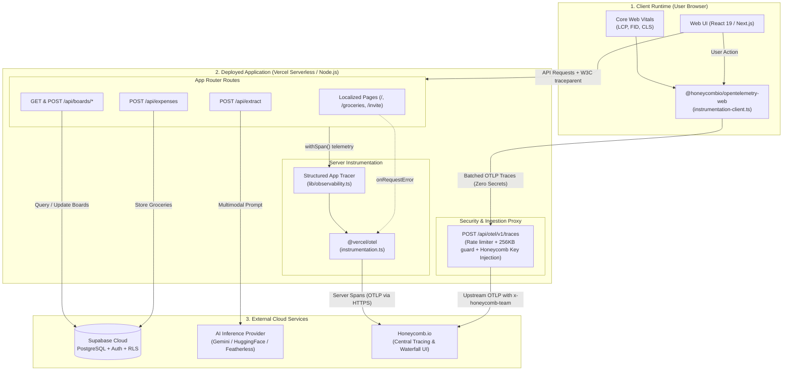
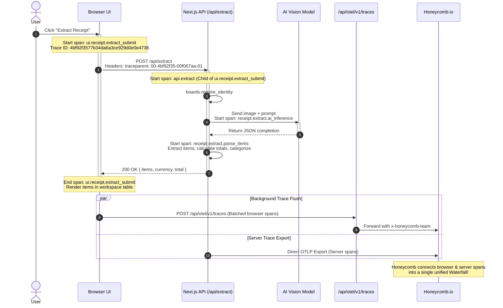

# Observability Architecture & Telemetry Guide

This document explains the end-to-end observability architecture in **Receipt AI** (`receipt-parser-agg`): what pieces exist, where the app is deployed, how telemetry flows without leaking credentials, and the exact spans and events captured across every layer.

---

## 1. Executive Summary: The Observability Story

In an AI-powered receipt aggregator, user experience depends on multiple distributed operations:
1. Uploading high-resolution receipts or PDFs from the browser.
2. Invoking multimodal AI models (e.g. Google Gemini, Featherless / HuggingFace) with low latency.
3. Parsing complex JSON extractions into line items, categories, and totals.
4. Persisting data into Supabase (PostgreSQL with Row-Level Security) and synchronizing shared household boards.

To ensure performance, track AI inference times, and catch edge cases immediately, this repository implements **full-stack OpenTelemetry (OTel)** instrumented for [Honeycomb.io](https://www.honeycomb.io):

* **Single Distributed Trace**: A user action in the browser (e.g., clicking *"Extract"*) creates a trace that flows seamlessly across the client and server via W3C `traceparent` headers.
* **Zero Secret Leakage**: Browser telemetry never exposes the Honeycomb API key. Traces are routed through an internal Next.js proxy route ([`/api/otel/v1/traces`](file:///c:/Users/thiag/Documents/projects/antigravity/receipt-parser-agg/app/api/otel/v1/traces/route.ts)) that attaches secrets securely on the server.
* **Resilient by Default**: When telemetry keys are absent (such as in local test environments), the system absorbs spans gracefully with zero performance degradation or network errors.

---

## 2. High-Level Architecture & Moving Pieces

The diagram below illustrates the deployment topology, runtime components, and telemetry data flow:



### Where Everything Lives
* **Frontend & Backend Hosting**: Deployed on **Vercel** (`https://receipt-parser-agg.vercel.app`) using Next.js 15+ App Router serverless functions.
* **Database & Auth**: Hosted on **Supabase Cloud** (managed PostgreSQL with row-level security, auth webhooks, and foreign key constraints).
* **AI Extraction Engine**: Multimodal vision models hosted on **HuggingFace Inference API** / **Featherless AI** / **Google Gemini**.
* **Observability Destination**: **Honeycomb.io** receiving OpenTelemetry Protocol (OTLP/HTTP) data.

---

## 3. The Zero-Secret-Leak Browser Proxy

A common vulnerability in Single Page Applications is leaking telemetry API tokens by placing them in client bundles (e.g. `NEXT_PUBLIC_HONEYCOMB_KEY`). This project prevents that by design:

```mermaid
sequenceDiagram
    autonumber
    participant Browser as Browser Client
    participant Proxy as /api/otel/v1/traces (Server Route)
    participant Honeycomb as Honeycomb.io

    Browser->>Proxy: POST /api/otel/v1/traces (Batched Protobuf/JSON payload, no API key)
    Note over Proxy: 1. Verify Rate Limits (Redis-backed token bucket)<br/>2. Guard max payload size (&le; 256 KB)<br/>3. Read server environment variable HONEYCOMB_API_KEY
    alt Key is Configured
        Proxy->>Honeycomb: Forward POST to api.honeycomb.io/v1/traces<br/>(Header: x-honeycomb-team: $HONEYCOMB_API_KEY)
        Honeycomb-->>Proxy: 200 OK
        Proxy-->>Browser: 200 OK
    else Key Unset (Local / Dev)
        Proxy-->>Browser: 200 OK {"status": "acknowledged"}
        Note over Proxy: Absorbs telemetry cleanly without network errors
    end
```

---

## 4. Key Setup Files & Responsibilities

The observability stack consists of six core files:

| File | Scope | Primary Responsibility |
| :--- | :--- | :--- |
| [`instrumentation.ts`](file:///c:/Users/thiag/Documents/projects/antigravity/receipt-parser-agg/instrumentation.ts) | Server | Bootstraps `@vercel/otel`, sets server `serviceName: "receipt-ai-frontend"`, records app metadata (`app.name`, `app.runtime`), and binds to Next.js `onRequestError`. |
| [`instrumentation-client.ts`](file:///c:/Users/thiag/Documents/projects/antigravity/receipt-parser-agg/instrumentation-client.ts) | Browser | Initializes `@honeycombio/opentelemetry-web`, attaches Web Vitals instrumentation, limits trace header propagation to same-origin requests, and routes traces to `/api/otel/v1/traces`. |
| [`app/api/otel/v1/traces/route.ts`](file:///c:/Users/thiag/Documents/projects/antigravity/receipt-parser-agg/app/api/otel/v1/traces/route.ts) | Security Proxy | Serverless route handler that enforces a 256 KB payload cap, applies rate limiting, injects `x-honeycomb-team`, and proxies OTLP batches upstream. |
| [`lib/observability.ts`](file:///c:/Users/thiag/Documents/projects/antigravity/receipt-parser-agg/lib/observability.ts) | Shared Utility | Provides `withSpan`, `startSpan`, `recordSpanError`, and structured loggers (`logInfo`, `logWarn`, `logError`) that automatically bind the active `traceId` and `spanId`. |
| [`lib/observability-schema.ts`](file:///c:/Users/thiag/Documents/projects/antigravity/receipt-parser-agg/lib/observability-schema.ts) | Type Registry | Strict constants for all custom span attributes (`observabilityAttributes`) and structured log events (`observabilityEvents`). |
| [`otel-collector-config.yaml`](file:///c:/Users/thiag/Documents/projects/antigravity/receipt-parser-agg/otel-collector-config.yaml) | Ops / Standalone | Ready-to-use configuration for teams running a dedicated OpenTelemetry Collector daemon in Docker or Kubernetes. |

---

## 5. Catalog of Traces, Spans & Events

All spans and events follow strict naming conventions to facilitate clean queries, waterfall filtering, and alerting in Honeycomb.

### 5.1 UI & Browser Spans

| Span Name | Initiator | What It Measures |
| :--- | :--- | :--- |
| `ui.receipt.extract_submit` | User clicks *"Extract"* in workspace | Full round-trip time of uploading the receipt file to `/api/extract` and receiving parsed items. |
| `ui.receipt.save_groceries` | User clicks *"Save to Dashboard"* | Network latency and result of saving parsed receipt expenses to `/api/expenses`. |
| `ui.boards.switch_active` | User switches board tab | Time to switch the active household board in the dashboard. |
| `ui.boards.create` | User creates a new board | Dialog submission and server response for creating a new shared board. |
| `ui.boards.invites.create` | User generates an invite link | Creation of a new role-based board invite link. |

### 5.2 Server & API Route Spans

| Span Name | File / Location | What It Measures |
| :--- | :--- | :--- |
| `api.extract` | `app/api/extract/route.ts` | Complete server handling for parsing receipt images or PDFs. |
| `api.boards.get` | `app/api/boards/route.ts` | Fetching the list of boards for the authenticated user. |
| `api.boards.create` | `app/api/boards/route.ts` | Creating and initializing a new shared board in Supabase. |
| `api.boards.active.set` | `app/api/boards/active/route.ts` | Updating the user's last active board preference. |
| `api.boards.members.get` | `app/api/boards/[boardId]/members/route.ts` | Retrieving board members and permission levels. |
| `api.boards.invites.create` | `app/api/boards/[boardId]/invites/route.ts` | Generating a cryptographically random invite token. |
| `api.invites.accept.post` | `app/api/invites/accept/route.ts` | Processing an invitation acceptance and adding user to board. |

### 5.3 Domain & AI Service Spans

| Span Name | File / Location | What It Measures |
| :--- | :--- | :--- |
| `receipt.extract.ai_inference` | `app/api/extract/route.ts` | Vendor-neutral multimodal model inference latency (sending base64 image/PDF prompt to AI provider). |
| `receipt.extract.parse_items` | `app/api/extract/route.ts` | Time spent validating, sanitizing, and categorizing raw JSON returned by the model. |
| `boards.require_identity` | `lib/boards-server.ts` | Session verification and identity extraction from NextAuth cookies. |
| `boards.ensure_profile` | `lib/boards-server.ts` | Checking user existence and auto-creating default boards on first sign-in. |
| `boards.resolve_active` | `lib/boards-server.ts` | Resolving which board to display (requested ID vs. last active vs. default). |
| `boards.require_access` | `lib/boards-server.ts` | Verifying user role permissions (owner, editor, viewer) for a target board. |
| `auth.get_session_identity` | `lib/session.ts` | Fast token decoding and session caching. |
| `invite.page.details` | `app/[locale]/invite/page.tsx` | SSR lookup of invite metadata without burning the single-use token on GET. |
| `db.<table_name>.<operation>` | `lib/observability.ts` | Standardized database operations (`select`, `insert`, `update`, `delete`, `rpc`). |

---

## 6. Semantic Attributes & Structured Events

Spans are enriched with standardized attributes defined in [`lib/observability-schema.ts`](file:///c:/Users/thiag/Documents/projects/antigravity/receipt-parser-agg/lib/observability-schema.ts):

### OpenTelemetry GenAI Semantic Conventions
* `gen_ai.system`: AI provider backend (`"featherless"`, `"huggingface"`, `"gemini"`).
* `gen_ai.request.model`: Model requested (e.g. `"meta-llama/Llama-3.2-11B-Vision-Instruct"`).
* `gen_ai.response.model`: Model returned by the inference server.
* `gen_ai.usage.input_tokens`: Exact prompt/image tokens consumed.
* `gen_ai.usage.output_tokens`: Exact completion tokens generated.
* `gen_ai.usage.total_tokens`: Total token footprint for calculating USD cost per receipt.
* `gen_ai.response.finish_reasons`: Stop reason (`"stop"`, `"length"` for token truncation, etc.).

### Database Semantic Conventions
* `db.system`: Database engine (`"postgresql"`).
* `db.collection.name`: Table targeted (`"boards"`, `"board_members"`, `"expenses"`).
* `db.operation`: Operation performed (`"select"`, `"insert"`, `"update"`, `"delete"`, `"rpc"`).
* `db.response.returned_rows`: Number of rows returned by query.

### Application & Receipt Attributes
* `app.name`: Service identifier (`"receipt-ai"`).
* `app.runtime`: Runtime environment (`"browser"` or `"nextjs"`).
* `app.receipt.model`: Name of the model invoked.
* `app.receipt.provider`: Inference provider name.
* `app.receipt.item_count`: Number of line items identified in the receipt.
* `app.receipt.max_output_tokens`: Configured token ceiling.
* `app.receipt.raw_response_length`: Size in characters of raw model output.
* `app.receipt.file_size_bytes`: Original uploaded image/PDF file size in bytes.
* `app.receipt.mime_type`: Uploaded file MIME type (`"image/jpeg"`, `"image/png"`, `"application/pdf"`).
* `app.board.user_role`: User privilege on current board (`"owner"`, `"editor"`, `"viewer"`).
* `app.http.status_code`: HTTP status returned for the operation.

### Structured Events
Logs recorded via `logInfo`, `logWarn`, and `logError` include correlated `traceId` and `spanId` alongside formal event tags:
* `ui.receipt.extract_success` / `ui.receipt.extract_failed`
* `receipt.extraction.completed`
* `ui.receipt.save_success` / `ui.receipt.save_failed`
* `ui.boards.create_success` / `ui.boards.switch_success`
* `api.invites.accept.success` / `api.invites.accept.request_failed`

---

## 7. The Life of a Receipt Request: End-to-End Walkthrough

Here is the exact journey of a trace when a user uploads a receipt image:



---

## 8. Environment Variables & Configuration

### Server Configuration (Vercel Project Settings)
```env
# Honeycomb ingest key (kept private on server)
HONEYCOMB_API_KEY="your-honeycomb-ingest-key"

# Standard OTel variables used by @vercel/otel
OTEL_SERVICE_NAME="receipt-ai-frontend"
OTEL_EXPORTER_OTLP_ENDPOINT="https://api.honeycomb.io"
OTEL_EXPORTER_OTLP_HEADERS="x-honeycomb-team=your-honeycomb-ingest-key"
```

### Browser Configuration (Public Variables)
```env
# Enables browser tracing
NEXT_PUBLIC_OTEL_BROWSER_ENABLED=true

# Environments where browser tracing activates
NEXT_PUBLIC_OTEL_BROWSER_ENABLED_ENVIRONMENTS="development,preview,production"

# Service name in Honeycomb
NEXT_PUBLIC_OTEL_BROWSER_SERVICE_NAME="receipt-ai-browser"

# Points to internal security proxy (default: /api/otel/v1/traces)
NEXT_PUBLIC_OTEL_BROWSER_COLLECTOR_URL="/api/otel/v1/traces"

# Sample rate: 1.0 = 100% of browser sessions
NEXT_PUBLIC_OTEL_BROWSER_SAMPLE_RATE=1
```

---

## 9. Honeycomb Query Cheat Sheet

Once data arrives in Honeycomb, use these queries in **Query Builder**:

### 1. View Complete Waterfall Traces
* **Filter**: `service.name = receipt-ai-browser` or `service.name = receipt-ai-frontend`
* **Time Range**: Last 15 minutes
* **Tab**: Select **Traces** tab under the chart to view full waterfall execution trees.

### 2. Identify AI Inference Latency Distribution
* **Calculation**: `P95(duration_ms)`, `AVG(duration_ms)`, `MAX(duration_ms)`
* **Filter**: `name = receipt.extract.ai_inference`
* **Group By**: `gen_ai.request.model`

### 3. Track Token Usage & Inference Cost
* **Calculation**: `SUM(gen_ai.usage.total_tokens)`, `AVG(gen_ai.usage.input_tokens)`, `AVG(gen_ai.usage.output_tokens)`
* **Filter**: `name = receipt.extract.ai_inference`
* **Group By**: `gen_ai.system`

### 4. Track Extraction Errors & Token Overflows
* **Calculation**: `COUNT`
* **Filter**: `error = true` or `event = ui.receipt.extract_failed`
* **Group By**: `error.message`

### 5. Monitor Rate Limiting (429 Status)
* **Calculation**: `COUNT`
* **Filter**: `app.http.status_code = 429`

---

## 10. Related Guides & Documentation
* [Honeycomb Tracing Setup Guide](file:///c:/Users/thiag/Documents/projects/antigravity/receipt-parser-agg/docs/honeycomb-tracing-setup.md) - In-depth technical guide for verifying trace delivery and collector relays.
* [Honeycomb User Guide](file:///c:/Users/thiag/Documents/projects/antigravity/receipt-parser-agg/docs/honeycomb-user-guide.md) - Plain-language step-by-step setup guide for non-developers.

---

## 11. Known Trade-offs & Production Scaling Architecture

The current observability implementation is engineered for rapid iteration, zero external infrastructure dependencies, and client credential safety. As transaction volume scales toward high-throughput production, the following architectural evolutions and trade-offs apply:

### 11.1 The "Vercel Tax" vs. Dedicated Edge Ingestion
* **The Current Trade-off**: Routing browser spans through [`/api/otel/v1/traces`](file:///c:/Users/thiag/Documents/projects/antigravity/receipt-parser-agg/app/api/otel/v1/traces/route.ts) completely eliminates client API key leakage. However, on Vercel, every browser telemetry batch constitutes a billable serverless function invocation accompanied by a Redis rate-limiter check.
* **Production Evolution**: At high scale, telemetry ingestion should be offloaded from Next.js serverless lambdas to a zero-cost-at-rest Edge Worker (e.g., Cloudflare Worker with strict CORS) or a dedicated OpenTelemetry Collector container on Fly.io or GCP Cloud Run ([`otel-collector-config.yaml`](file:///c:/Users/thiag/Documents/projects/antigravity/receipt-parser-agg/otel-collector-config.yaml)).
* **Tab Closure Safeguards**: Client-side spans are explicitly flushed via `sdk.forceFlush()` registered on `visibilitychange` (`hidden`) and `pagehide`, ensuring spans are not dropped when users rapidly navigate away or close tabs.

### 11.2 GenAI Token Economics & Truncation Detection
* **Standardized Conventions**: By adopting OpenTelemetry's `gen_ai.*` semantic conventions (`gen_ai.usage.input_tokens`, `gen_ai.usage.output_tokens`, `gen_ai.usage.total_tokens`), teams can calculate precise USD cost per receipt extraction directly in Honeycomb.
* **Distinguishing Truncations from Failures**: Tracking `gen_ai.response.finish_reasons` immediately flags receipts that truncated due to max token limits (e.g., extremely long itemized supermarket slips) versus genuine schema validation errors.

### 11.3 Database Observability: Application-Perceived Latency vs. Postgres RLS Execution
* **What Spans Measure**: Standard HTTP spans or database wrapper spans (`db.<table_name>.<operation>`) measure the application's perceived round-trip time:
  $$\text{Application Latency} = \text{Next.js egress} + \text{Network transit} + \text{PostgREST parsing} + \text{PostgreSQL RLS evaluation} + \text{Serialization} + \text{Ingress}$$
* **Isolating Postgres Engine Time**: A client wrapper cannot isolate PostgreSQL CPU execution time from network transit. To analyze whether latency originates from slow PostgreSQL Row-Level Security (RLS) sequential scans or network transit:
  1. Inspect Supabase's built-in `pg_stat_statements` dashboard for raw server-side query execution metrics.
  2. Call `.explain()` on complex PostgREST queries during query optimization and index tuning.

### 11.4 Sampling Strategy: MVP Full Retention vs. Tail-Based Refinery
* **Why `SAMPLE_RATE = 1` for MVP**: During initial rollout and development, 100% trace capture ensures zero blind spots when diagnosing rare edge-case bugs.
* **Production Scaling**: Under high volume, 100% browser sampling exhausts ingest quotas. The production scaling policy transitions to:
  - **100% Retention** on errors (`error = true`), 429 rate limit events, and AI extraction calls (`api.extract`).
  - **Head-sampling down to 5% (`0.05`)** on routine 200 OK browser navigation and board clicks.
  - **Tail-based sampling** via Honeycomb Refinery or an OpenTelemetry Collector to preserve anomalous and high-latency traces while shedding repetitive successful traces.

### 11.5 PII Defense & Telemetry Sanitization
* **Data Minimization**: Receipt images contain personal items, payment card fragments, and merchant locations.
* **Active Scrubbing**: All error recording via `recordSpanError` and structured logging via `logInfo`/`logError` automatically route through a PII scrubber in [`lib/observability.ts`](file:///c:/Users/thiag/Documents/projects/antigravity/receipt-parser-agg/lib/observability.ts). It redacts payment card numbers (`[REDACTED_CARD]`), emails (`[REDACTED_EMAIL]`), bearer tokens, and truncates exception strings longer than 500 characters to prevent unparsed JSON blobs from entering Honeycomb.

### 11.6 Vendor-Neutral AI Span Architecture
* The primary AI inference span is standardized as `receipt.extract.ai_inference` rather than being hardcoded to a specific vendor. The underlying model and provider are dynamically parameterized via `app.receipt.provider`, `gen_ai.system`, and `gen_ai.request.model`, ensuring continuous historical telemetry across model migrations between Gemini, Featherless, and HuggingFace.
